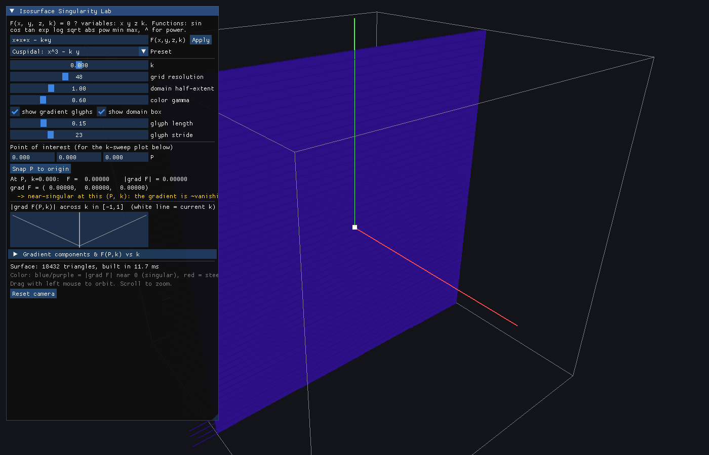

# Isosurface Singularity Lab

An interactive C++ tool for exploring **unfoldings of singular isosurfaces**:
implicit surfaces `F(x,y,z,k) = 0` where some particular value of a
parameter `k` makes the surface singular (the gradient `∇F` vanishes at a
point where `F=0`), and other values of `k` "unfold" the singularity into a
smooth surface.

Type a formula, drag `k` across `[-1, 1]`, and watch:

- the isosurface update live, extracted on a grid with a tetrahedral
  marching-cubes algorithm;
- the surface **colored by `|∇F|`** — dark blue/purple where the gradient
  is close to zero (near-singular), red where it's steep (regular);
- optional **gradient glyphs**: short line segments showing the exact
  analytic gradient direction at sampled surface points;
- a live plot of `|∇F|` (and each component `∂F/∂x, ∂F/∂y, ∂F/∂z`) at a
  chosen point, swept over `k ∈ [-1,1]`, with a cursor marking the current
  `k` — so you can watch the gradient collapse to zero and recover as `k`
  crosses the critical value.



## Why the gradient is exact, not finite-differenced

The gradient shown everywhere in the app — on the mesh, in the glyphs, in
the readout, in the sweep plot — is **not** estimated with finite
differences. The formula you type is parsed into an expression tree once;
that tree is then evaluated with a tiny forward-mode automatic
differentiation number (`Dual3`, see `src/Dual3.h`): every `x`, `y`, `z` is
seeded with its own unit partial derivative, and every `+ - * / ^ sin cos
sqrt exp log ...` carries the derivatives through via the standard
calculus rule (product rule, chain rule, etc). The result is the *exact*
value and the *exact* gradient of your function at that point, to floating
point precision — which matters a lot right at a singularity, where a
finite-difference gradient estimate becomes numerically unreliable exactly
where you most want to trust it.

## Why marching *tetrahedra*, not the classic 256-case marching cubes table

Surface extraction (`src/Isosurface.h`) splits each grid cube into 6
tetrahedra sharing the cube's main diagonal, then cuts each tetrahedron
(only 3 non-trivial cases: 1, 2, or 3 of its 4 corners "inside"). This is
the standard, well-known cube-decomposition variant of marching cubes. It
was chosen over the classic 256-entry edge/triangle lookup table because:

- it has no ambiguous-face cases (a known correctness issue with plain
  marching cubes that needs an "asymptotic decider" to fix properly),
- within one tetrahedron the cut of a *linear* field is always an exact
  plane, so there's no triangulation ambiguity to resolve, and
- it's simple enough to implement and verify directly, rather than
  transcribing a large table by hand.

It produces a few more, slightly smaller triangles than classic marching
cubes for the same grid, but is topologically equivalent and, for this
tool's purpose (precise, correct visualization of a gradient field near a
singularity), robustness mattered more than triangle count.

This is verified by an included test suite (`tests/test_isosurface.cpp`):
it checks that an extracted sphere's vertices lie on the sphere with the
correct analytic radial gradient, that `x^3 - k*y` has `|∇F| = 0`
*everywhere* on the surface at `k=0` and does not for `k≠0`, and that a
closed mesh is watertight (every triangle edge is shared by exactly 2
triangles — no cracks). Run it with `ctest` after building (see below).

## Building

Requires a C++17 compiler and CMake ≥ 3.15. Needs an OpenGL driver (any
normal desktop GPU/driver is fine) and internet access the first time you
configure (it fetches GLFW and Dear ImGui via `FetchContent`, unless you
already have a GLFW dev package installed, in which case it uses that).

```bash
cmake -S . -B build -DCMAKE_BUILD_TYPE=Release
cmake --build build -j
./build/isosurface_lab
```

**Linux (Debian/Ubuntu)** — speeds up the first configure a lot, and is
the only package you need beyond a compiler:
```bash
sudo apt install libglfw3-dev libglu1-mesa-dev
```

**macOS**: `brew install glfw cmake`, then build as above (Xcode command
line tools needed for the compiler).

**Windows**: open the folder in Visual Studio (CMake integration) or run
the same two `cmake` commands from a Developer Command Prompt; GLFW and
Dear ImGui are fetched automatically.

### Running the correctness tests

```bash
cmake --build build --target isosurface_lab_tests
ctest --test-dir build --output-on-failure
```

## Using it

- **`F(x,y,z,k)`** — type any expression in `x`, `y`, `z`, `k`. Supports
  `+ - * / ^` (power), unary minus, parentheses, and the functions `sin
  cos tan exp log sqrt abs pow(a,b) min(a,b) max(a,b)`, plus the constants
  `pi` and `e`. Press Enter or click **Apply**.
- **Preset** dropdown — a few classic singularity-unfolding families to
  start from:
  - `x^3 - k y` — a cuspidal family; `∇F = (3x², -k, 0)` vanishes
    identically on the whole plane `x=0` at `k=0`.
  - `x² + y² - z² - k` — a cone at `k=0` that unfolds into a
    one-sheeted (`k>0`) or two-sheeted (`k<0`) hyperboloid.
  - `x²z - y² - k z` — a Whitney-umbrella-like family.
  - `x³ - 3xy² - k` — a monkey-saddle family.
  - a cubic surface family with a `k·xyz` coupling term.
- **k** — the unfolding parameter, `[-1, 1]`.
- **grid resolution / domain half-extent** — controls the marching
  tetrahedra grid. If a surface disappears near the domain edge (e.g. the
  hyperboloid preset near `k=±1`), increase the domain half-extent.
- **Point of interest `P`** — where the bottom plot evaluates `∇F` as `k`
  sweeps from -1 to 1. Defaults to the origin (the singular point for the
  built-in presets); change it to probe other points.
- **Mouse**: left-drag to orbit the camera, scroll to zoom.

## Project layout

```
src/Dual3.h        forward-mode AD number (value + exact gradient)
src/Expr.h          expression parser + templated AST evaluator
src/Isosurface.h    marching-tetrahedra isosurface extraction
src/Camera.h        minimal orbit camera (no GLU dependency)
src/main.cpp        GLFW + Dear ImGui application, rendering & UI
tests/test_isosurface.cpp   standalone correctness tests (no GL deps)
```

# 1. Basic correctness
ctest --test-dir build --output-on-failure \
  -R '^isosurface_correctness$'

# 2. Quick singularity diagnostics
ctest --test-dir build --output-on-failure \
  -R '^singularity_diagnostics_smoke$'

# 3. Earlier k sweep
ctest --test-dir build --output-on-failure \
  -R '^singularity_k_sweep$'